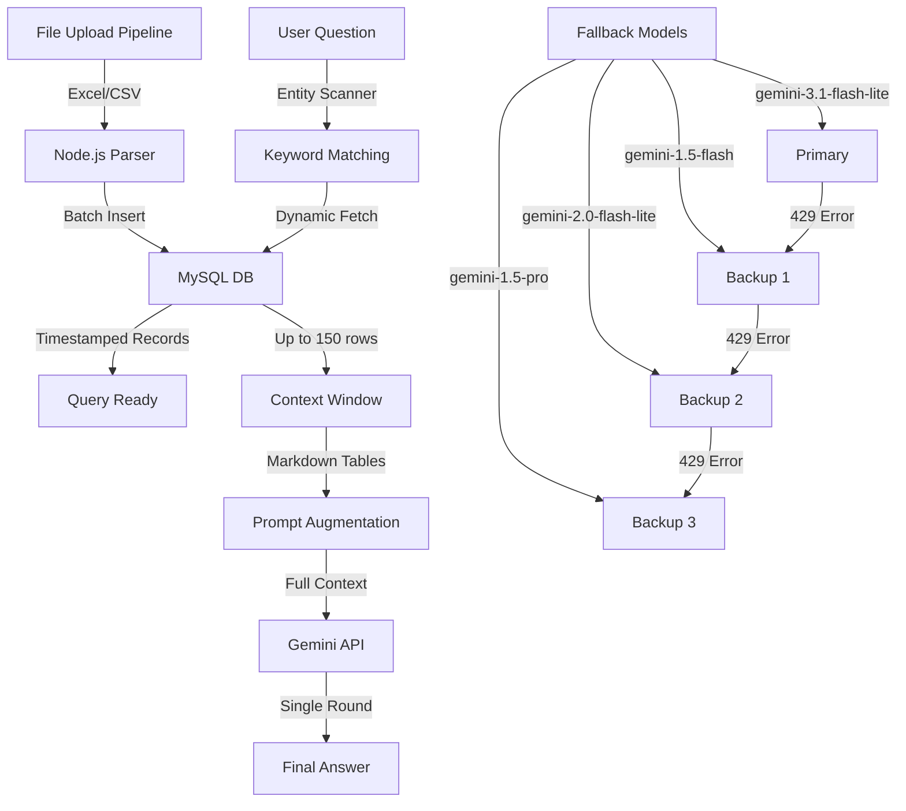

# In-Context RAG Bot Backend

A high-performance, single-round In-Context Retrieval-Augmented Generation (RAG) chatbot backend built using FastAPI and Google Gemini.

---

## System Architecture & Data Pipelines



### 1. The File Upload Pipeline (How Ingestion Works)
When an administrator uploads a feedback Excel (`.xlsx` or `.csv`) file in the frontend portal, the following sequence occurs:
1. **Parsing:** The Node.js server parses the uploaded file sheet records.
2. **Batch DB Write:** Rows are processed and bulk-inserted into the MySQL `feedback_records` table (linked to a file metadata ID in `upload_sessions`).
3. **Instant Visibility:** The timestamped feedback records are instantly queryable in MySQL.

### 2. The Retrieval & Context Pipeline (How Data Gets to the AI)
Rather than translating user prompts into SQL commands (which takes 2 LLM rounds and can cause syntax or join errors), this server uses an **In-Context RAG** pipeline:
1. **Entity Scanner (Python):** When a user asks a question, Python quickly scans the question text against the list of active trainers, courses, and departments.
   - **TTL Reference Cache:** To prevent database overload, reference lists (trainers, courses, batches) and aggregate counts are cached in-memory with a **30-second TTL**. New entities added to the database are resolved dynamically within 30 seconds without requiring a server restart.
   - **Disambiguation:** If a token match is ambiguous and maps to multiple trainers (e.g. searching for `"Arjun"` when `"Dr. Arjun"` and `"Arjun D"` both exist), a `[SYSTEM ALERT]` is dynamically injected into the context prompt to instruct the LLM to ask for user clarification or compare the feedback for both while calling out the ambiguity.
2. **Dynamic Database Fetch & Paths:**
   - **Metadata-Only Path:** If a query is classified as a general system metadata request (e.g. asking for database counts, active trainers list, course lists, or greetings) and contains no specific trainer or department criteria, feedback row fetching is skipped entirely. Only reference metadata is injected, saving prompt token usage and database load.
   - **Targeted Entity Fetch:** If keywords match specific trainers or departments, Python queries MySQL *only* for feedback records associated with those entities (up to 150 rows).
   - **Fallback General Fetch:** If no specific keywords match and the query is not metadata-only (e.g. general feedback questions), it fetches a dynamic context slice of the 30 most recent feedback records.
3. **Prompt Augmentation:** Python structures the returned database rows, trainer list, course list, and batch codes into Markdown tables and injects them directly into the AI's prompt.
4. **Single-Round Generation:** Gemini reads the entire prompt context window and writes the final answer in a single round.

### 3. Multi-Model Fallback Chain (How Quota Limits Are Managed)
Free-tier Gemini API keys have strict rate limits and daily quotas. To solve this, the server implements an automatic fallback cycle:
* **The Cycle:** The code contains a list of models:
  ```python
  _FALLBACK_MODELS = [
      "gemini-3.1-flash-lite",  # 1st Choice (Primary)
      "gemini-1.5-flash",       # 2nd Choice (Backup Fast)
      "gemini-2.0-flash-lite",  # 3rd Choice (Backup 2.0)
      "gemini-1.5-pro"          # 4th Choice (Premium Backup)
  ]
  ```
* **How it triggers:** If a model returns a `429 RESOURCE_EXHAUSTED` or quota limit error, the server catches the exception, updates the active LLM setting to the next model in the chain, and instantly retries the request.

---

## Context Window Capabilities & Limitations

| Model | Context Window Limit | Max Feedback Rows Processable | Latency Profile |
|---|---|---|---|
| **gemini-3.1-flash-lite** | **1,000,000 Tokens** | ~10,000 Feedback Rows | ~2.5s (Warm) |
| **gemini-1.5-flash** | **1,000,000 Tokens** | ~10,000 Feedback Rows | ~2.7s (Warm) |
| **gemini-1.5-pro** | **2,000,000 Tokens** | ~20,000 Feedback Rows | ~4.5s (Warm) |

### Key Limitations
1. **Dynamic Slice Limits:** We limit query context to 150 rows for targeted queries and 30 rows for general queries to keep network latency under **3 seconds**. Limits can be adjusted in configuration.
2. **Context Window vs. Cost:** Although Gemini can hold 1M+ tokens (equivalent to hundreds of files), large context sizes increase token costs and execution times. Dynamic filtering solves this by only fetching relevant records.

---

## Performance & Latency Breakdown

The backend features multiple speed optimizations (local greetings, response cache, and dynamic database slicing context retrieval) coupled with a **600ms minimum psychological latency pacing** to satisfy the "Labor Illusion":

| Query Scenario | Average Time | Execution Path | Performance vs. Old System |
|---|---|---|---|
| **Greetings / Hello** | **~600ms** | Welcome regex path + 600ms Pacing Delay | **~14x Faster (was ~8.7s)** |
| **Repeat Queries** | **~600ms** | In-memory Response Cache + 600ms Pacing Delay | **~14x Faster (was ~8.7s)** |
| **New Database Queries** | **~2.7s** | Dynamic Entity Retrieve + Single LLM round | **~3x Faster (was ~8.7s)** |
| **Quota Recovery Queries** | **~7.5s - 11s** | Model Fallback Retries (Automatic Recovery) | **Robust (no crash/error)** |

### Psychological Latency Pacing (The Labor Illusion)
To prevent instantaneous responses (like cache hits or greetings that execute in <1ms) from feeling robotic, fake, or "alien" to the user, the backend enforces a minimum target response time of **600ms**. If database query and LLM processing finish faster than 600ms, the server sleeps for the remaining time to simulate natural pacing.

---

## Setup & Running

1. **Install Dependencies:**
   ```bash
   pip install -r requirements.txt
   ```

2. **Configure Environment:**
   Create a `.env` file in the root directory (you can copy `.env.example` as a template) and explicitly define the following configuration variables:
   - `GEMINI_API_KEY`: Your Google Gemini API Key.
   - `DATABASE_URL`: Connection string for MySQL. Format: `mysql+pymysql://<DB_USER>:<DB_PASSWORD>@<DB_HOST>:<DB_PORT>/<DB_NAME>`
     - `<DB_USER>`: Database user account username.
     - `<DB_PASSWORD>`: Database user account password.
     - `<DB_HOST>`: Database host server address (e.g. `localhost` or remote endpoint).
     - `<DB_PORT>`: Database port (default `3306`).
     - `<DB_NAME>`: The database schema name (e.g. `profice_feedback`).
   - `RAG_PORT`: The API port to run the server on (default `8000`).

3. **Run the Server:**
   ```bash
   python fastapi_rag.py
   ```
